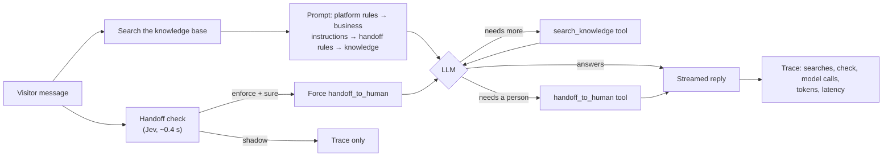

# Support Agent Harness

A customer-support AI agent that answers from a business's knowledge base and hands the chat to a human when it should, with evals that measure both.

It is the agent core of [OmniHands](https://omnihandai.com), a SaaS I built where businesses put an AI support agent on their website. This repo extracts that core into something you can run, read and test in a few minutes, using a made-up hotel as the business.

**What's in it**

- **Retrieval before the model:** the knowledge base is searched before the first LLM call, so most answers need one model call instead of two.
- **Tool calling:** the model can still search again itself, or hand off to a person.
- **Human handoff** driven by the business's own rules, plus a second opinion from a fast classifier ([Jev](https://www.langchain.com/blog/building-a-harness-with-jev)), with `shadow` and `enforce` modes.
- **Prompt-injection defence:** retrieved text is fenced off as data, never instructions.
- **Hard limits:** caps on model calls, searches and total time, so a confused model can't loop or run up a bill.
- **52 offline tests** using a scripted model and classifier, with no API keys needed.
- **Two evals** on labelled data, with the results below.

## Results

Measured with `gpt-6-luna` on the sample hotel. Reproduce with `uv run python -m evals.run_answers` and `uv run python -m evals.run_handoff`.

### Searching before the model makes answers faster and cheaper, with no accuracy cost

24 questions, each run both ways:

| Setup | Correct | Model calls / answer | Median time to first words | Input tokens / answer |
|---|---|---|---|---|
| **Search before the model** | 24/24 | **1.25** | **1.6 s** | **1,042** |
| Tool-only (the model decides when to search) | 24/24 | 2.00 | 2.4 s | 1,435 |

That's 35% faster to first words and 27% fewer input tokens. The model can still search again when the first results don't cover the question, which is why the average is 1.25 calls rather than 1.

### The classifier is a good second opinion, but only at the right threshold

60 hand-labelled messages: requests for a person (including Spanish, French and Roman Urdu), the business's four handoff rules, ordinary questions, and near misses such as *"What's your refund policy?"*, which mentions refunds but isn't a refund request.

| Setup | Accuracy | Missed handoffs | Wrong handoffs |
|---|---|---|---|
| LLM only | 100% | 0 | 0 |
| Jev only (threshold 0.85) | 90% | 4 | 2 |
| LLM + Jev, enforce at 0.85 | 97% | 0 | **2** |
| **LLM + Jev, enforce at 0.95** | **100%** | **0** | **0** |

Jev answered in **429 ms** (median) for **$0.024 per 1,000 messages**. It runs while the knowledge is searched, so turn latency didn't change.

**What I concluded from this:**

1. **The LLM alone was already perfect on this set.** Adding the classifier at the default threshold made things *worse*: it was over-confident on two near misses ("How long does a refund take?" scored 0.88 for the refund rule).
2. **At 0.95 the classifier made no false calls on this set,** so enforcing there costs nothing, while the LLM catches the softer cases ("operator", "I don't want to talk to a bot").
3. **So the harness ships the check in `shadow` mode by default.** It records the classifier's opinion next to the LLM's decision on real traffic. Only once those agree should it be switched to `enforce`, and at a high threshold. That's how it is rolled out in OmniHands.

Full per-case results, including every miss with its score, are in [`evals/results/`](evals/results).

**Limits of these numbers:**
- 60 and 24 cases, hand-written by me, for one fictional business.
- The 0.95 threshold was chosen on the same 60 cases it is scored on, so it needs a held-out set before anyone should trust it.
- Answers are graded by phrase match: a floor, not a judge.

## How a turn works



A real turn from `demo.py --check shadow`:

```
you> The receptionist was really rude to me last night
ava> [handed to a person: rule_matched. Guest reports that the receptionist was really
     rude to them last night. Please follow up regarding their complaint about staff.]
     I'm sorry you were treated that way. I've connected you with a teammate, who will
     reply here shortly.
  · search before the model: 'The receptionist was really rude to me last night': 0 found (320 ms)
  · model call 1: asked for handoff_to_human (2001 ms)
  · handoff_to_human: rule_matched: Guest reports that the receptionist was really rude ...
  · model call 2: wrote the reply (1444 ms)
  · handoff check: would hand off: rule_matched (frustrated 0.83, sensitive 0.96, best rule 0.97) (384 ms)
```

## Design decisions

| Decision | Why |
|---|---|
| **Search before the first model call** | Without it, the model spends a whole call deciding to search. Short follow-ups ("how much is it?") are searched together with the previous question, which says what "it" is. |
| **Prompt in a fixed order, platform rules first** | The business can't edit or override the safety rules. Retrieved knowledge sits between `<knowledge>` markers and is declared to be information, never instructions, so a document saying "ignore your rules" changes nothing. |
| **Hard limits per turn** | A cap on model calls, a cap per tool, and a whole-turn timeout. The agent runs in its own task, so a timeout cancels the agent, never the caller. |
| **Failures become events, never exceptions** | A search outage tells the model it can't check. A model error ends the turn with `TurnFailed`, and the caller shows a fallback. |
| **The agent is a closed box** | Everything comes in (agent spec, a searcher locked to one business, model, decider) and everything goes out as events. No web framework or database inside, which is why the tests run offline. |
| **A classifier for the handoff decision, rolled out in shadow mode first** | One call answers every yes/no question in parallel, in about 0.4 s, for a fraction of a cent. Enforcing it blind would have added wrong handoffs (see Results). |
| **When enforcing, force the tool instead of writing the reply** | `tool_choice` makes the first model call `handoff_to_human`, so the normal flow still writes the reason, the summary for the teammate, and the visitor-facing wording. If the business requires steps first ("ask for the booking number"), the model is told rather than forced. |
| **Small chunks for FAQ-style knowledge** | At 400 tokens whole pages merged into one vector, and "Can I bring my dog?" scored 0.29 against them, below the 0.3 cut-off. At about one section per chunk (80 tokens), the Pets section scores 0.40 and ranks first. |

## Run it

Requires Python 3.13 and [uv](https://docs.astral.sh/uv/).

```bash
uv sync
uv run pytest                          # 52 tests, offline, no keys

cp .env.example .env                   # add OPENAI_API_KEY (and JEV_API_KEY for the check)
uv run python demo.py                  # chat with the hotel's agent in the terminal
uv run python demo.py --check shadow   # with the handoff check in the trace
uv run python -m evals.run_answers     # about 50 model calls
uv run python -m evals.run_handoff     # about 180 model calls + 60 Jev calls
```

## Layout

```
harness/
  runner.py       one turn: search + check in parallel, the agent loop, streaming, trace
  prompts.py      the fixed-order system prompt
  tools.py        search_knowledge, handoff_to_human
  checks.py       the handoff check and the middleware that enforces it
  decisions.py    the classifier interface, the Jev client, a scripted fake
  knowledge/      section-aware chunking, embeddings, in-memory vector search
  config.py       every tunable setting, validated
data/northwind_hotel/   the sample business: knowledge base + agent settings
evals/            labelled cases, runners, and saved results
tests/            offline tests with a scripted model and classifier
demo.py           terminal chat
```

The sample business, Northwind Hotel, is fictional. OmniHands itself runs this core behind FastAPI, with Pinecone instead of the in-memory index, a live inbox for the human side, and a website widget.

## License

MIT
